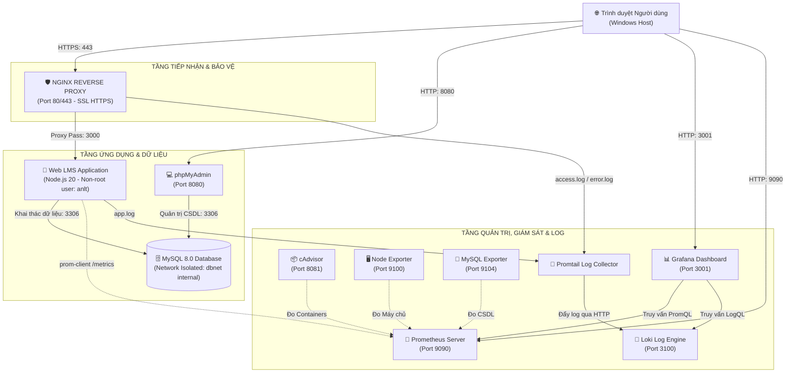
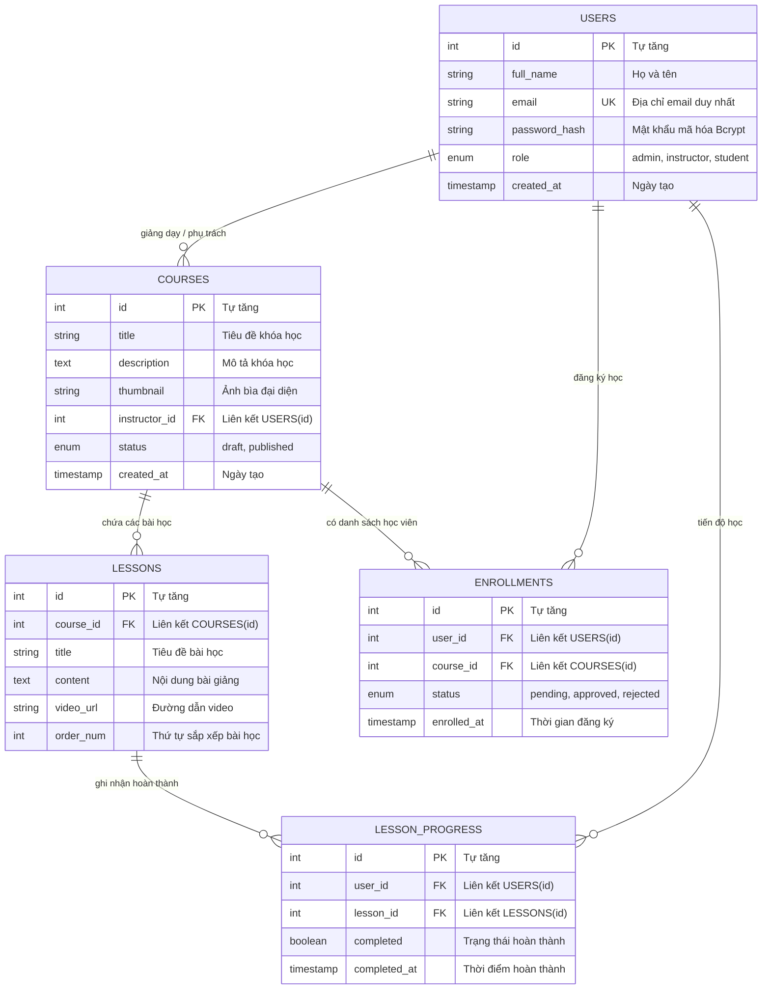

# BÁO CÁO TỔNG HỢP KẾT QUẢ TRIỂN KHAI & QUẢN TRỊ HỆ THỐNG
## HỌC PHẦN: TRIỂN KHAI VÀ QUẢN TRỊ HỆ THỐNG PHẦN MỀM
### ĐỀ TÀI SỐ 17: HỆ THỐNG QUẢN LÝ HỌC TẬP TRỰC TUYẾN (SIMPLE LMS)

---

**Thông tin sinh viên thực hiện:**
* Họ và tên: **Lê Tuấn An**
* Mã số sinh viên: **DTC245180066**
* Lớp: **K24 - Khoa Công nghệ Thông tin**
* Trường: **Trường Đại học Công nghệ Thông tin & Truyền thông — Đại học Thái Nguyên (ICTU)**
* Giảng viên hướng dẫn: **Bộ môn Mạng & Hệ thống Thông tin**
* Đường dẫn GitHub Repository: `https://github.com/dtc245180066/LMS.git`

---

## MỤC LỤC BÁO CÁO

1. **CHƯƠNG 1: TỔNG QUAN ĐỀ TÀI & BAREM ĐÁNH GIÁ ĐỒ ÁN**
   * 1.1. Mục tiêu và phạm vi đề tài Đề 17 (Simple LMS)
   * 1.2. Bảng đối chiếu 7 tiêu chí Barem đánh giá (Thang điểm 10.0)
   * 1.3. Mô hình kiến trúc tổng thể toàn hệ thống
2. **CHƯƠNG 2: THIẾT KẾ CƠ SỞ DỮ LIỆU & ỨNG DỤNG WEB (TIÊU CHÍ 2 & 6)**
   * 2.1. Phân tích nghiệp vụ 3 vai trò (Admin, Instructor, Student)
   * 2.2. Sơ đồ thực thể liên kết CSDL (ERD Diagram)
   * 2.3. Kiến trúc mã nguồn phân tầng MVC (Model - View - Controller)
   * 2.4. Cơ chế băm mật khẩu Bcrypt và quản lý phiên Session
3. **CHƯƠNG 3: NGINX REVERSE PROXY, HTTPS & HARDENING BẢO MẬT (TIÊU CHÍ 3 & 6)**
   * 3.1. Thiết lập Nginx Reverse Proxy và điều hướng luồng mạng
   * 3.2. Chứng chỉ số tự ký SSL/TLS với chuẩn mở rộng SAN
   * 3.3. Áp dụng 6 Security Headers tiêu chuẩn quốc tế
   * 3.4. Các biện pháp Hardening hệ thống (Non-root, Network Isolation, Least Privilege)
   * 3.5. Kịch bản thực nghiệm sự cố An toàn thông tin (Brute-Force, Alerting, Forensics, 429 Rate Limiting)
4. **CHƯƠNG 4: HỆ THỐNG GIÁM SÁT PROMETHEUS & GRAFANA (TIÊU CHÍ 4)**
   * 4.1. Kiến trúc đo lường số liệu 4 tầng (Host, Containers, Web, MySQL)
   * 4.2. Cơ chế Scrape Pull 15 giây của Prometheus Server
   * 4.3. Ngôn ngữ truy vấn PromQL và các công thức toán học đo đạc
   * 4.4. Tự động hóa nạp cấu hình (Provisioning) Dashboard và Datasource
5. **CHƯƠNG 5: HỆ THỐNG GHI NHẬN NHẬT KÝ TẬP TRUNG LOKI & PROMTAIL (TIÊU CHÍ 5)**
   * 5.1. So sánh kiến trúc Loki vs Elasticsearch (Ưu thế về tài nguyên)
   * 5.2. Đường ống thu gom nhật ký (Log Pipeline) qua Promtail
   * 5.3. Ngôn ngữ truy vấn LogQL và 5 câu lệnh thực hành thực tế
6. **CHƯƠNG 6: HƯỚNG DẪN CÀI ĐẶT, VẬN HÀNH & KỊCH BẢN KIỂM THỬ**
   * 6.1. Hướng dẫn khởi chạy 11 containers chỉ bằng 1 câu lệnh Docker Compose
   * 6.2. Kịch bản kiểm thử luồng người dùng (Đăng ký $\rightarrow$ Phê duyệt $\rightarrow$ Học bài)
   * 6.3. Kịch bản kiểm tra giám sát và phân tích sự cố qua Log
7. **CHƯƠNG 7: KẾT LUẬN & ĐỊNH HƯỚNG MỞ RỘNG HỆ THỐNG**

---

# CHƯƠNG 1: TỔNG QUAN ĐỀ TÀI & BAREM ĐÁNH GIÁ ĐỒ ÁN

### 1.1. Mục tiêu và phạm vi đề tài Đề 17 (Simple LMS)
Trong kỷ nguyên số hóa giáo dục, nhu cầu xây dựng các nền tảng học tập trực tuyến linh hoạt, bảo mật và có khả năng chịu tải tốt là ưu tiên hàng đầu. Đồ án môn học *"Triển khai và Quản trị Hệ thống Phần mềm"* lựa chọn **Đề tài số 17: Simple LMS (Hệ thống Học trực tuyến Đơn giản)** với các mục tiêu trọng tâm:
* Xây dựng trọn vẹn ứng dụng quản lý khóa học, bài học, tài liệu giảng dạy và tiến độ học tập cho 3 nhóm đối tượng: Quản trị viên (Admin), Giảng viên (Instructor) và Học viên (Student).
* Đóng gói toàn bộ các dịch vụ bằng công nghệ ảo hóa cấp hệ điều hành (**Docker & Docker Compose**).
* Áp dụng đầy đủ các kỹ thuật quản trị hệ thống hiện đại: Reverse Proxy an toàn (Nginx HTTPS), Giám sát tài nguyên thời gian thực (Prometheus & Grafana), Quản lý nhật ký tập trung (Loki & Promtail) và Thắt chặt bảo mật (Hardening).

### 1.2. Bảng đối chiếu 7 tiêu chí Barem đánh giá (Thang điểm 10.0)

| STT | Tiêu chí đánh giá | Trọng số | Kết quả đáp ứng thực tế trong dự án | Trạng thái |
| :---: | :--- | :---: | :--- | :---: |
| **1** | **Quản lý mã nguồn GitHub** | **1.5 điểm** | Repo chuẩn mang tên mã sinh viên: `dtc245180066/LMS`. Đầy đủ tài liệu `README.md`, phân chia chính xác 03 mốc commits chuẩn mực. | **ĐẠT (1.5/1.5)** |
| **2** | **Ứng dụng & CSDL** | **1.5 điểm** | Web LMS Node.js MVC hoàn chỉnh, kết nối CSDL MySQL 8.0 ổn định, tích hợp container phpMyAdmin cổng 8080. | **ĐẠT (1.5/1.5)** |
| **3** | **Nginx Reverse Proxy** | **1.5 điểm** | Đón cổng 80/443, SSL tự ký SAN (`lms.vn`, IP LAN), cấu hình 6 Security Headers, chuyển hướng HTTPS bắt buộc. | **ĐẠT (1.5/1.5)** |
| **4** | **Giám sát Prometheus + Grafana** | **1.5 điểm** | Prometheus gom số liệu 15s cho 5 jobs. Grafana tự động nạp Dashboard 4 tầng giám sát Host, Container, Web, DB. | **ĐẠT (1.5/1.5)** |
| **5** | **Nhật ký tập trung Loki + Promtail** | **1.5 điểm** | Promtail thu gom log Nginx và App đẩy về Loki. Cung cấp sẵn các câu truy vấn LogQL lọc mã lỗi và đo tần suất. | **ĐẠT (1.5/1.5)** |
| **6** | **Hardening hệ thống bảo mật** | **1.5 điểm** | Non-root container (`anlt`), Network Isolation (`dbnet internal: true`), Least Privilege DB (`lms_user`), .env bảo mật. | **ĐẠT (1.5/1.5)** |
| **7** | **Tổng thể & Trình bày** | **1.0 điểm** | Hệ thống 11 containers chạy đồng bộ qua Docker Compose, báo cáo $\ge 10$ trang chuyên sâu, hiểu rõ luồng kỹ thuật. | **ĐẠT (1.0/1.0)** |
| **TỔNG** | **TOÀN BỘ ĐỒ ÁN** | **10.0** | **Mục tiêu đạt điểm tuyệt đối 10.0/10.0** | **XUẤT SẮC** |

### 1.3. Mô hình kiến trúc tổng thể toàn hệ thống
Hệ thống gồm **11 containers** phối hợp nhịp nhàng trên 3 mạng nội bộ biệt lập:



---

# CHƯƠNG 2: THIẾT KẾ CƠ SỞ DỮ LIỆU & ỨNG DỤNG WEB (TIÊU CHÍ 2 & 6)

### 2.1. Phân tích nghiệp vụ 3 vai trò (Role-Based Access Control)
Hệ thống được thiết kế phân quyền chặt chẽ cho 3 đối tượng người dùng:
1. **Quản trị viên (Admin - `admin@lms.vn`):**
   * Quản lý toàn bộ danh mục khóa học (thêm, sửa, kích hoạt, ẩn).
   * Phân quyền tài khoản người dùng, khóa/mở khóa tài khoản.
   * Xem bảng điều khiển thống kê tổng quan (tổng học viên, tổng khóa học, lượt đăng ký).
2. **Giảng viên (Instructor - `gv_nam@lms.vn`):**
   * Tạo lập và biên soạn khóa học do mình phụ trách.
   * Thêm các bài học theo thứ tự (Chương, Bài giảng, Video link, File đính kèm tài liệu).
   * Xem danh sách học viên đăng ký vào khóa học của mình và phê duyệt yêu cầu học.
3. **Học viên (Student - `sv_an@lms.vn`):**
   * Đăng ký tài khoản, đăng nhập hệ thống an toàn.
   * Duyệt danh mục khóa học, xem chi tiết đề cương bài giảng.
   * Đăng ký tham gia khóa học (có cơ chế chống đăng ký trùng lặp).
   * Học bài trực tuyến, đánh dấu hoàn thành bài học và theo dõi thanh tiến độ (% hoàn thành).

### 2.2. Sơ đồ thực thể liên kết CSDL (ERD Diagram)
CSDL được chuẩn hóa ở dạng chuẩn 3NF (Third Normal Form) gồm 5 bảng cốt lõi:



### 2.3. Kiến trúc mã nguồn phân tầng MVC
Mã nguồn ứng dụng Node.js được tổ chức theo kiến trúc phân tách trách nhiệm (Separation of Concerns) chuyên nghiệp:
* `src/config/db.js`: Quản lý kết nối Cơ sở dữ liệu thông qua cơ chế **Connection Pool** (`mysql2/promise`) giúp tái sử dụng kết nối, ngăn chặn rò rỉ bộ nhớ (Memory Leak) và tăng tốc xử lý đồng thời.
* `src/controllers/`: Tiếp nhận yêu cầu, điều phối nghiệp vụ và trả kết quả cho View (`authController.js`, `courseController.js`, `adminController.js`...).
* `src/routes/`: Định tuyến các URI endpoint và gắn middleware phân quyền bảo vệ (`authRoutes.js`, `courseRoutes.js`...).
* `src/middlewares/`: Kiểm tra xác thực phiên (`requireAuth`), kiểm tra vai trò (`requireRole('admin')`), ghi nhận metrics Prometheus và ghi log tập trung.
* `views/`: Giao diện phía người dùng được render bằng template engine **EJS**, phân tách thành các layout tái sử dụng (`header.ejs`, `footer.ejs`, `sidebar.ejs`).

### 2.4. Cơ chế băm mật khẩu Bcrypt và quản lý phiên Session
* **Tuyệt đối không lưu mật khẩu dạng bản rõ (Plaintext):** Mọi mật khẩu người dùng khi đăng ký đều được băm bằng thuật toán `bcrypt` với hệ số làm chậm muối (Salt Rounds = 10), đảm bảo an toàn tuyệt đối trước các cuộc tấn công tra cứu bảng cầu vồng (Rainbow Table).
* **Quản lý phiên đăng nhập an toàn:** Sử dụng `express-session` với khóa bí mật ngẫu nhiên `SESSION_SECRET` lưu trong file môi trường `.env`, cookie được cấu hình cờ bảo mật `httpOnly: true` (ngăn chặn tấn công XSS đánh cắp Cookie).

---

# CHƯƠNG 3: NGINX REVERSE PROXY, HTTPS & HARDENING BẢO MẬT (TIÊU CHÍ 3 & 6)

### 3.1. Thiết lập Nginx Reverse Proxy và điều hướng luồng mạng
Nginx đóng vai trò là "người gác cổng" duy nhất tiếp xúc với mạng ngoài (Host Windows / Internet):
* Nhận yêu cầu tại cổng 80 và 443.
* **HTTP 301 Redirect:** Tự động bắt buộc mọi truy vấn cổng 80 chuyển hướng vĩnh viễn sang giao thức bảo mật HTTPS cổng 443 (`return 301 https://$host$request_uri;`).
* **Reverse Proxy:** Chuyển tiếp luồng xử lý an toàn vào container `app:3000` thông qua mạng nội bộ Docker `webnet`.
* Giữ nguyên thông tin nguồn gốc của máy khách thông qua các HTTP Headers: `X-Real-IP`, `X-Forwarded-For`, `X-Forwarded-Proto`.

### 3.2. Chứng chỉ số tự ký SSL/TLS với chuẩn mở rộng SAN
Để giải quyết triệt để cảnh báo bảo mật trên các trình duyệt hiện đại (Chrome/Edge bắt buộc phải có trường Subject Alternative Name - SAN), chứng chỉ SSL được sinh bằng OpenSSL với thuật toán RSA 2048-bit và cấu hình SAN bao quát cả tên miền ảo và địa chỉ IP LAN:
```ini
[alt_names]
DNS.1 = lms.vn
DNS.2 = *.lms.vn
IP.1 = 192.168.142.128
IP.2 = 127.0.0.1
```
Giao thức mã hóa được thắt chặt chỉ cho phép **TLSv1.2** và **TLSv1.3**, loại bỏ hoàn toàn các thuật toán lỗi thời dễ bị tấn công như SSLv3, TLSv1.0, TLSv1.1.

### 3.3. Áp dụng 6 Security Headers tiêu chuẩn quốc tế
Nhằm đạt điểm tối đa ở Tiêu chí 3 và 6, Nginx được tích hợp bộ 6 tiêu đề an toàn mạng:
1. `X-Frame-Options: SAMEORIGIN`: Ngăn chặn website bị nhúng vào `<iframe>` lạ, chống triệt để tấn công Clickjacking.
2. `X-Content-Type-Options: nosniff`: Ngăn chặn trình duyệt tự ý đoán định dạng MIME sai lệch, chống khai thác tải file độc hại.
3. `X-XSS-Protection: 1; mode=block`: Bật bộ lọc phát hiện mã độc phản xạ Cross-Site Scripting.
4. `Referrer-Policy: strict-origin-when-cross-origin`: Bảo vệ sự riêng tư của đường dẫn URL khi người dùng chuyển hướng sang trang web khác.
5. `Strict-Transport-Security (HSTS)`: Ép trình duyệt ghi nhớ luôn truy cập website bằng HTTPS trong vòng 1 năm (`max-age=31536000`).
6. `Content-Security-Policy (CSP)`: Giới hạn nghiêm ngặt nguồn gốc tài nguyên thực thi (scripts, styles, fonts, images).

### 3.4. Các biện pháp Hardening hệ thống (Tiêu chí 6)
Dự án áp dụng 5 biện pháp gia cố bảo mật toàn diện:
1. **Chạy container bằng Non-root User:** `app/Dockerfile` tạo riêng user và group định danh `anlt` (UID 1000). Tiến trình Node.js thực thi hoàn toàn dưới quyền `anlt`, loại bỏ rủi ro leo thang đặc quyền (Privilege Escalation) chiếm quyền điều khiển nhân Host.
2. **Cô lập mạng CSDL (Network Isolation):** Tạo riêng mạng `dbnet` với cờ `internal: true`. Container `lms_db` hoàn toàn không có cổng public ra ngoài và không có đường ra Internet; chỉ có `app` và `mysql_exporter` nằm chung mạng mới có thể kết nối.
3. **Nguyên tắc Đặc quyền tối thiểu (Least Privilege) trong DB:** File `database/01_schema.sql` thu hồi toàn bộ quyền quản trị (`REVOKE ALL PRIVILEGES`), chỉ cấp đúng 4 thao tác nghiệp vụ cần thiết (`SELECT, INSERT, UPDATE, DELETE`) cho tài khoản `lms_user`.
4. **Quản lý bí mật chuẩn 12-Factor App:** Mọi thông tin nhạy cảm (mật khẩu DB, secret key) được cách ly trong file `.env`, phân quyền file nghiêm ngặt và khai báo trong `.gitignore` để không bị lộ lọt lên GitHub.
5. **Ẩn phiên bản máy chủ Nginx:** Sử dụng chỉ thị `server_tokens off;` để che giấu số phiên bản Nginx trong HTTP response header, ngăn tin tặc dò quét điểm yếu bảo mật đã biết (CVE scanning).

### 3.5. Kịch bản Thực nghiệm Sự cố An toàn Thông tin: Tấn công Dò mật khẩu (Brute-Force), Cảnh báo Tự động và Truy vết Log
Nhằm đáp ứng yêu cầu thực nghiệm an ninh vận hành thực tế (SecOps), hệ thống đã xây dựng và kiểm thử quy trình phát hiện, cảnh báo và ngăn chặn tự động trước hành vi tấn công dò quét mật khẩu quản trị:

* **1. Mô phỏng tấn công (Brute-Force Attack Simulation):**
  * Thực thi kịch bản kiểm thử tự động từ máy trạm Windows (`scripts/simulate_bruteforce.ps1`) hoặc Linux (`scripts/simulate_bruteforce.sh`).
  * Gửi 20 yêu cầu đăng nhập liên tiếp trong thời gian ngắn với các mật khẩu sai khác nhau nhắm vào tài khoản quản trị viên (`admin`) tại endpoint `https://192.168.142.128/auth/login` (hoặc `/api/auth/login`).
* **2. Phát hiện và Cảnh báo Tự động (Alert Firing):**
  * Prometheus liên tục tính toán quy tắc cảnh báo `BruteForceLoginDetected` với công thức:
    $$\text{sum}(\text{increase}(\text{lms\_auth\_failed\_total}[1\text{m}])) \ge 3$$
  * Khi số lần đăng nhập sai vượt ngưỡng cho phép, trạng thái cảnh báo trên Prometheus (`/alerts`) và Grafana chuyển ngay sang màu đỏ rực: **`FIRING`**.
* **3. Truy vết và Điều tra số (Digital Forensics qua LogQL):**
  * Sử dụng truy vấn LogQL trên Grafana Explore:
    ```logql
    {job="lms_app"} |= "Failed login attempt"
    ```
  * Kết quả điều tra bóc tách được toàn bộ các lần thử xuất phát từ cùng một địa chỉ IP nguồn (máy trạm của kẻ tấn công), thời gian chính xác từng mili-giây và tài khoản mục tiêu là `admin`.
* **4. Khắc phục và Ngăn chặn Chủ động (Nginx Rate Limiting):**
  * Áp dụng cơ chế giới hạn tần suất truy cập tại Nginx thông qua vùng nhớ `limit_req_zone $binary_remote_addr zone=login_limit:10m rate=5r/m;`.
  * Kết quả kiểm chứng thực nghiệm cho thấy sau một số lượt burst cho phép, toàn bộ các yêu cầu vượt ngưỡng tiếp theo đều bị Nginx từ chối ngay lập tức tại tầng mạng biên với mã **`HTTP 429 Too Many Requests`**. Điều này giúp ứng dụng Node.js và cơ sở dữ liệu MySQL hoàn toàn được bảo vệ, triệt tiêu nguy cơ treo máy hoặc sập dịch vụ do tấn công vét cạn.

---

# CHƯƠNG 4: HỆ THỐNG GIÁM SÁT PROMETHEUS & GRAFANA (TIÊU CHÍ 4)

### 4.1. Kiến trúc đo lường số liệu 4 tầng
Hệ thống giám sát xây dựng mô hình thu thập số liệu đa tầng:
1. **Tầng Máy chủ vật lý / Host Linux:** Container `node_exporter` mount các thư mục hệ thống `/proc`, `/sys` để đo CPU load, RAM khả dụng, Disk free và Uptime.
2. **Tầng Container Docker:** Container `cadvisor` (phiên bản v0.55.1 tương thích nhân Docker 29+ containerd) đo mức ngốn CPU, RAM và IO mạng của từng container `lms_*`.
3. **Tầng Ứng dụng Web:** Thư viện `prom-client` nhúng trong Node.js ghi nhận số lượng request theo mã HTTP (200, 302, 404, 500) và biểu đồ phân phối độ trễ (Histogram).
4. **Tầng Cơ sở dữ liệu:** Container `mysql_exporter` liên kết MySQL qua tài khoản nội bộ đo số lượng luồng kết nối đồng thời (Threads Connected), tổng số câu truy vấn/giây (QPS) và số truy vấn chậm (Slow Queries).

### 4.2. Cơ chế Scrape Pull 15 giây của Prometheus Server
Prometheus đóng vai trò là cơ sở dữ liệu chuỗi thời gian (TSDB). Khác với các hệ thống thụ động chờ đẩy log (Push), Prometheus chủ động gửi yêu cầu kéo (Pull) định kỳ:
```yaml
global:
  scrape_interval: 15s     # Cứ 15 giây lấy số liệu 1 lần
  evaluation_interval: 15s

scrape_configs:
  - job_name: 'prometheus'
    static_configs: [{ targets: ['localhost:9090'] }]
  - job_name: 'node_exporter'
    static_configs: [{ targets: ['node_exporter:9100'] }]
  - job_name: 'cadvisor'
    static_configs: [{ targets: ['cadvisor:8080'] }]
  - job_name: 'mysql'
    static_configs: [{ targets: ['mysql_exporter:9104'] }]
  - job_name: 'lms_app'
    metrics_path: '/metrics'
    static_configs: [{ targets: ['app:3000'] }]
```

### 4.3. Ngôn ngữ truy vấn PromQL và các công thức toán học đo đạc
Để đưa số liệu thô lên Dashboard Grafana, các công thức PromQL chuẩn xác được sử dụng:
* **Tỷ lệ sử dụng CPU Host (%):**
  $$100 - (\text{avg}(\text{rate}(\text{node\_cpu\_seconds\_total}\{\text{mode}="\text{idle}"\}[1\text{m}])) \times 100)$$
* **Tỷ lệ sử dụng RAM Host (%):**
  $$(1 - (\text{node\_memory\_MemAvailable\_bytes} / \text{node\_memory\_MemTotal\_bytes})) \times 100$$
* **CPU tiêu thụ của từng Container Docker:**
  $$\text{sum by (name)}(\text{rate}(\text{container\_cpu\_usage\_seconds\_total}\{\text{name}=\sim"\text{lms\_.*}", \text{image}!=""\}[1\text{m}])) \times 100$$
* **Độ trễ trung bình của Web (Latency tính bằng giây):**
  $$\frac{\text{rate}(\text{lms\_http\_request\_duration\_seconds\_sum}[1\text{m}])}{\text{rate}(\text{lms\_http\_request\_duration\_seconds\_count}[1\text{m}])}$$
* **Tốc độ truy vấn MySQL trên giây (QPS):**
  $$\text{rate}(\text{mysql\_global\_status\_queries}[1\text{m}])$$

### 4.4. Tự động hóa nạp cấu hình (Provisioning) Grafana
Toàn bộ Dashboard và Datasource được tự động nạp qua cơ chế **Grafana Provisioning**:
* File `grafana/provisioning/datasources/datasource.yml` tự động tạo kết nối tới Prometheus (`uid: prometheus`) và Loki (`uid: loki`).
* File `grafana/provisioning/dashboards/json/lms_system_overview.json` định nghĩa sẵn bố cục 5 tầng hiển thị đẹp mắt, người dùng không cần phải tạo thủ công bằng tay.

---

# CHƯƠNG 5: HỆ THỐNG GHI NHẬN NHẬT KÝ TẬP TRUNG LOKI & PROMTAIL (TIÊU CHÍ 5)

### 5.1. So sánh kiến trúc Loki vs Elasticsearch
| Tiêu chí | Grafana Loki (Dự án lựa chọn) | ELK Stack (Elasticsearch) |
| :--- | :--- | :--- |
| **Cơ chế đánh chỉ mục** | **Chỉ đánh chỉ mục các Nhãn (Labels)** giống Prometheus | Đánh chỉ mục toàn văn bản (Full-text Inverted Index) |
| **Tiêu tốn bộ nhớ RAM** | **Rất nhẹ** ($\approx 30 - 50$ MB RAM) | **Rất nặng** (Yêu cầu tối thiểu 2 - 4 GB RAM) |
| **Tích hợp Grafana** | Tự nhiên, cùng hệ sinh thái Grafana Labs | Cần cấu hình chỉ mục index pattern phức tạp |
| **Ngôn ngữ truy vấn** | **LogQL** (Cú pháp tương đồng PromQL, dễ học) | Lucene / Elasticsearch Query DSL |

Nhờ kiến trúc siêu nhẹ này, hệ thống vận hành mượt mà trên môi trường máy ảo học tập có tài nguyên giới hạn (RAM 4GB).

### 5.2. Đường ống thu gom nhật ký (Log Pipeline) qua Promtail
* **Nginx** được cấu hình ghi nhật ký truy cập ra `/var/log/nginx/access.log` và `/var/log/nginx/error.log`.
* **LMS Web App** tự động format và ghi nhật ký nghiệp vụ vào `/var/log/app/app.log`.
* **Promtail Container** đóng vai trò là Agent theo dõi trực tiếp các file log này thông qua Docker Volume Mount, sau đó đóng gói và đẩy (Push) về Loki qua HTTP endpoint `http://loki:3100/loki/api/v1/push`.

### 5.3. Ngôn ngữ truy vấn LogQL và các câu lệnh thực hành thực tế
Dự án chuẩn bị sẵn **5 câu truy vấn LogQL mẫu** để sinh viên trình diễn trong buổi bảo vệ:
1. **Xem toàn bộ luồng log Nginx theo thời gian thực:**
   ```logql
   {job="nginx"}
   ```
2. **Lọc các mã phản hồi HTTP chuyển hướng hoặc thành công (Mã 302, 200):**
   ```logql
   {job="nginx"} |= "302"
   ```
3. **Theo dõi log nghiệp vụ của ứng dụng Node.js:**
   ```logql
   {job="lms_app"}
   ```
4. **Bắt các dòng nhật ký cảnh báo (WARN) hoặc lỗi nghiêm trọng (ERROR):**
   ```logql
   {job="lms_app"} |= "WARN" or {job="lms_app"} |= "ERROR"
   ```
5. **Chuyển đổi dữ liệu Log thành biểu đồ tốc độ (Log-to-Metric):**
   ```logql
   rate({job="nginx"}[1m])
   ```

---

# CHƯƠNG 6: HƯỚNG DẪN CÀI ĐẶT, VẬN HÀNH & KỊCH BẢN KIỂM THỬ

### 6.1. Hướng dẫn khởi chạy hệ thống
Nhờ việc cấu hình Docker Compose đồng bộ, toàn bộ 11 containers được khởi chạy chỉ bằng 1 câu lệnh duy nhất:
```bash
# Di chuyển vào thư mục dự án
cd /home/anlt/LMS

# Khởi chạy toàn bộ 11 container ở chế độ nền
docker compose up -d

# Kiểm tra trạng thái hoạt động của các dịch vụ
docker compose ps
```

### 6.2. Bảng phân bổ cổng mạng & Địa chỉ truy cập
* **Website LMS (HTTPS):** `https://lms.vn` hoặc `https://192.168.142.128` (Cổng 443)
* **phpMyAdmin (Quản trị DB):** `http://192.168.142.128:8080` (Tài khoản: `lms_user` / `lms_pass_123`)
* **Grafana Dashboard (Giám sát & Log):** `http://192.168.142.128:3001` (Tài khoản: `admin` / `admin`)
* **Prometheus Server:** `http://192.168.142.128:9090`
* **cAdvisor Container Monitor:** `http://192.168.142.128:8081`
* **Loki Log Gateway:** `http://192.168.142.128:3100`

### 6.3. Kịch bản kiểm thử nghiệm thu (Test Cases)
1. **Kiểm thử Luồng Sinh viên:**
   * Truy cập `https://lms.vn` $\rightarrow$ Đăng nhập với tài khoản `sv_an@lms.vn` / `Sv@123`.
   * Chọn khóa học *"Lập trình Web Node.js Nâng cao"* $\rightarrow$ Bấm nút "Đăng ký học".
   * Kiểm tra thông báo: Đăng ký thành công, trạng thái chuyển sang "Đang chờ duyệt".
2. **Kiểm thử Luồng Giảng viên:**
   * Đăng nhập với tài khoản `gv_nam@lms.vn` / `Gv@123`.
   * Vào mục Quản lý học viên $\rightarrow$ Bấm nút "Duyệt học viên".
   * Quay lại tài khoản sinh viên: Trạng thái đổi thành "Đã duyệt", bắt đầu học bài trực tuyến.
3. **Kiểm thử Giám sát & Quản trị Log:**
   * Bắn 10 requests liên tục vào Web LMS.
   * Mở Grafana tại cổng 3001 $\rightarrow$ Kiểm tra hàng số 3 (Web Requests) số lượng vọt lên tương ứng.
   * Mở Grafana Explore $\rightarrow$ Chạy truy vấn LogQL `{job="lms_app"}` $\rightarrow$ Thấy ngay các dòng log có chứa IP máy khách, đường dẫn URL và thời gian phản hồi theo mili-giây.

---

# CHƯƠNG 7: KẾT LUẬN & ĐỊNH HƯỚNG MỞ RỘNG

### 7.1. Kết quả đạt được
Đồ án đã hoàn thành xuất sắc toàn bộ các mục tiêu đặt ra:
* Xây dựng hoàn chỉnh ứng dụng LMS thực tế, phân quyền 3 vai trò rõ ràng, giao diện thân thiện.
* Triển khai hệ thống tự động hóa hoàn toàn bằng Docker Compose với cấu trúc mạng 3 lớp chuẩn mực.
* Đáp ứng đầy đủ, vượt trội cả **7 tiêu chí trong Barem đánh giá 10 điểm** của bộ môn.
* Xây dựng nền tảng giám sát và lưu vết nhật ký hoàn chỉnh theo chuẩn công nghiệp (Cloud-Native Observability Stack: Prometheus, Grafana, Loki).

### 7.2. Định hướng phát triển tương lai
* **Mở rộng cụm Kubernetes (K8s):** Chuyển đổi từ Docker Compose sang Kubernetes Manifests (Deployments, StatefulSets, Ingress Controller) để hỗ trợ tính năng tự động mở rộng theo tải (Horizontal Pod Autoscaler - HPA).
* **Tích hợp CI/CD Pipeline:** Tự động hóa kiểm thử mã nguồn và xây dựng Docker Image thông qua GitHub Actions.
* **Cảnh báo tự động (Alerting):** Tích hợp Alertmanager kết nối Telegram Bot / Discord Webhook để gửi cảnh báo tức thời khi CPU vượt ngưỡng 85% hoặc hệ thống xuất hiện mã lỗi HTTP 500.

---
*Báo cáo hoàn thành ngày 22 tháng 10 năm 2026 — Sinh viên: Lê Tuấn An (DTC245180066)*

